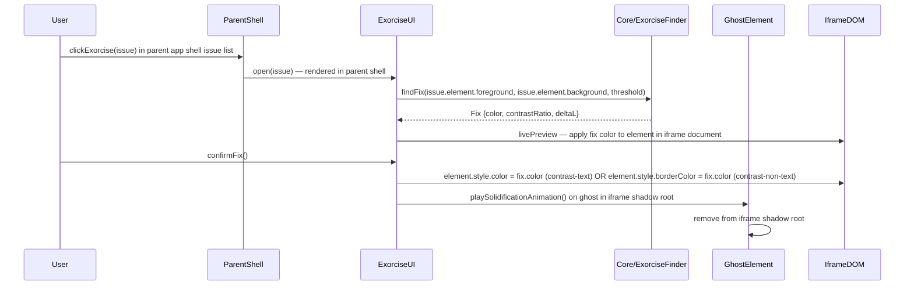

# Design Document

## Overview

Wraith is a haunted accessibility auditor for the Kiroween 2026 hackathon. It audits web pages for
WCAG 2.2 AA violations and renders failing elements as ghosts: each ghost's opacity, blur, and
spectral glow encode how inaccessible that element is. The "spooky effect IS the information."

Wraith ships as:
- A hosted demo web app (`apps/web`, Vite + Vercel)
- A Chrome Manifest V3 extension (`apps/extension`, stretch goal)

Both surfaces share:
- `packages/core` — pure accessibility logic, no browser globals, no axe-core
- `packages/overlay` — shadow DOM injection, ghost rendering, Possess filters, Exorcise UI

The design prioritises testability: `packages/core` is entirely pure so it runs in Node with mock
DOM data, making property-based testing straightforward. All browser interactions are funnelled
through a single `DOMInterface` injection point.

---

## Architecture

### Component Diagram

```mermaid
graph TD
  subgraph packages/core
    DI[DOMInterface]
    AUD[Auditor]
    SCORE[ScoreEngine]
    EXORC[ExorciseFinder]
    GHOST_MAP[GhostStyleMapper]
  end

  subgraph packages/overlay
    INJECT[OverlayInjector]
    GHOST_EL[GhostElement]
    POSSESS[PossessFilter]
    EXUI[ExorciseUI]
    AXE[AxeAdapter (optional)]
    SHADOW[ShadowRoot]
  end

  subgraph apps/web
    VITE[Vite App]
    LAND[LandingPage]
    DEMO[DemoFrames x3]
    PASTE[PasteHTMLMode]
    PANEL[ReportPanel]
  end

  subgraph apps/extension
    POPUP[Popup]
    CS[ContentScript]
    SW[ServiceWorker]
  end

  DI --> AUD
  AUD --> SCORE
  AUD --> GHOST_MAP
  AUD --> EXORC
  INJECT --> SHADOW
  SHADOW --> GHOST_EL
  SHADOW --> EXUI
  POSSESS --> VITE
  AUD -.injected DOMInterface.-> INJECT
  INJECT --> AUD
  VITE --> LAND
  VITE --> DEMO
  VITE --> PASTE
  VITE --> PANEL
  CS --> INJECT
  CS --> AUD
  POPUP --> SW
  SW --> CS
```

### Data Flow — Haunt Mode

```mermaid
sequenceDiagram
  participant User
  participant ParentShell
  participant Overlay
  participant Core/Auditor
  participant IframeDOM

  User->>ParentShell: activateHauntMode()
  ParentShell->>Overlay: audit(iframeDOMInterface)
  Overlay->>Core/Auditor: audit(domInterface)
  Core/Auditor->>IframeDOM: enumerate elements, getComputedStyle, getBoundingClientRect
  Core/Auditor-->>Overlay: AuditResult {issues[], hauntingScore, breakdown}
  Overlay->>IframeDOM: attachToAuditedDocument(iframe.contentDocument.body)
  Overlay->>IframeDOM: insert Ghost <div> elements into iframe shadow root
  Overlay->>IframeDOM: apply elementOpacity + elementBlur inline styles to each failing element
  Overlay->>ParentShell: renderReportPanel(result) — rendered in parent shell
  Overlay-->>User: Ghosts visible over failing elements; ReportPanel in parent shell
```

### Data Flow — Exorcise



### Monorepo Layout

```
wraith/
├── packages/
│   ├── core/
│   │   ├── src/
│   │   │   ├── dom-interface.ts      # DOMInterface type definitions
│   │   │   ├── auditor.ts            # Rule orchestration
│   │   │   ├── rules/
│   │   │   │   ├── contrast.ts       # contrast-text + contrast-non-text
│   │   │   │   ├── alt-text.ts       # alt-text
│   │   │   │   ├── tap-target.ts     # tap-target
│   │   │   │   └── label.ts          # label
│   │   │   ├── severity.ts           # Severity math per rule
│   │   │   ├── ghost-style.ts        # GhostStyleMapper
│   │   │   ├── score.ts              # ScoreEngine / HauntingScore
│   │   │   ├── exorcise.ts           # OKLCH fix search
│   │   │   └── color-utils.ts        # sRGB <-> OKLCH, luminance, contrast ratio
│   │   └── test/
│   │       ├── contrast.property.test.ts
│   │       ├── opacity.property.test.ts
│   │       ├── exorcise.property.test.ts
│   │       ├── score.property.test.ts
│   │       └── rules/*.unit.test.ts
│   └── overlay/
│       ├── src/
│       │   ├── injector.ts           # OverlayInjector, ShadowRoot management
│       │   ├── ghost.ts              # GhostElement creation + positioning
│       │   ├── possess.ts            # PossessFilter SVG matrices
│       │   ├── exorcise-ui.ts        # ExorciseUI component
│       │   ├── report-panel.ts       # ReportPanel component
│       │   └── axe-adapter.ts        # Optional axe-core cross-check
│       └── styles/
│           └── overlay.css           # Scoped ghost / panel styles (injected into shadow DOM)
├── apps/
│   ├── web/
│   │   ├── src/
│   │   │   ├── main.ts
│   │   │   ├── pages/
│   │   │   │   ├── Landing.ts
│   │   │   │   ├── Demo.ts           # iframe host + tab switcher
│   │   │   │   └── PasteHTML.ts      # sanitize + sandbox iframe
│   │   │   ├── design-tokens.css     # near-black violet, bone white, ectoplasm green…
│   │   │   └── gothic-fonts.css
│   │   ├── demos/
│   │   │   ├── cafe/index.html
│   │   │   ├── university/index.html
│   │   │   └── shop/index.html
│   │   └── vite.config.ts
│   └── extension/
│       ├── manifest.json
│       ├── popup/
│       │   ├── popup.html
│       │   └── popup.ts
│       └── content-script.ts
├── e2e/
│   └── haunt-exorcise.spec.ts        # Playwright E2E
├── pnpm-workspace.yaml
└── tsconfig.base.json
```

---

## Components and Interfaces

### packages/core — DOMInterface

`DOMInterface` is the single abstraction between Core logic and the real browser DOM. All audit
functions accept it as a parameter. Core never imports `document`, `window`, or any browser global.

```typescript
/** An element handle the Auditor may query. Opaque to Core. */
export type ElementHandle = object;

export interface DOMInterface {
  /** Return all elements matching the given CSS selector in document order. */
  querySelectorAll(selector: string): ElementHandle[];

  /** Return the computed style value for a CSS property on an element. */
  getComputedStyle(el: ElementHandle, property: string): string;

  /** Return the element's bounding client rect. */
  getBoundingClientRect(el: ElementHandle): Rect;

  /** Return the value of an attribute, or null if absent. */
  getAttribute(el: ElementHandle, name: string): string | null;

  /** Return true if the element has the given attribute. */
  hasAttribute(el: ElementHandle, name: string): boolean;

  /** Return the element's tag name in uppercase. */
  getTagName(el: ElementHandle): string;

  /** Return the element's inner text (trimmed). */
  getInnerText(el: ElementHandle): string;

  /** Return the parent element, or null for the root. */
  getParentElement(el: ElementHandle): ElementHandle | null;

  /** Return the element referenced by an ID (for aria-labelledby resolution). */
  getElementById(id: string): ElementHandle | null;

  /**
   * Return true if the element is an inline `<a>` surrounded by non-interactive
   * text content in the same block container (WCAG 2.5.8 inline exception).
   */
  isInlineAnchor(el: ElementHandle): boolean;

  /**
   * Return true if the element has at least one direct child text node
   * containing at least one non-whitespace character.
   */
  hasDirectText(el: ElementHandle): boolean;

  /**
   * Return true if the element is rendered:
   * - computed display is not 'none'
   * - computed visibility is not 'hidden'
   * - computed opacity > 0
   * - getBoundingClientRect has non-zero width and height
   */
  isRendered(el: ElementHandle): boolean;
}
```

A real-browser adapter (`packages/overlay`) wraps `document` to satisfy this interface. Tests
supply a plain-object mock. The adapter reads `element.getBoundingClientRect()` (which returns a
browser `DOMRect`) and maps it to the plain `Rect` type before passing it to Core.

### packages/core — Auditor

```typescript
export interface AuditOptions {
  /** Restrict rules to run. Defaults to all four rules. */
  rules?: RuleName[];
}

export type RuleName = 'contrast-text' | 'contrast-non-text' | 'alt-text' | 'tap-target' | 'label';

export interface AuditResult {
  issues: Issue[];
  hauntingScore: number;      // [0, 100] integer
  breakdown: RuleBreakdown;
}

export interface RuleBreakdown {
  [rule: string]: { count: number; meanSeverity: number };
}

export function audit(dom: DOMInterface, options?: AuditOptions): AuditResult;
```

The auditor runs each rule independently in document order and collects Issues. After collecting
Issues it calls `ScoreEngine.compute(issues)` and builds the breakdown.

### packages/core — Rule: contrast

Responsible for WCAG 1.4.3 (text) and 1.4.11 (non-text).

**Algorithm:**
1. For each element returned by `querySelectorAll('*')`:
   a. Skip if `!dom.isRendered(el)`.
   b. Skip if `!dom.hasDirectText(el)` (contrast-text only — elements with no direct text nodes are not text elements).
   c. Read `color` and `background-color` via `getComputedStyle`.
   d. Walk ancestor elements alpha-compositing background colors until a fully-opaque layer is found
      or the document root is reached (see Background Resolver below).
   e. If any ancestor has a `background-image` or gradient in its `background` shorthand or
      `background-image` property: produce an Issue with `status: 'needs-review'` and skip further
      contrast computation for that element.
   f. Compute `contrastRatio(foreground, composited_background)`.
   g. Determine the applicable threshold using font-size / font-weight rules (Requirement 1.2).
   h. If ratio < threshold: produce an Issue with Rule `contrast-text` or `contrast-non-text` and
      computed Severity (see Severity section).

**Background Resolver** (pure, testable in isolation):
```
resolveBackground(el, dom) → { color: RGBAColor; effectiveForeground: RGBAColor; hasGradient: boolean }

  // Phase 1: collect ancestor chain from el outward (innermost first)
  layers = []
  cursor = el
  WHILE cursor is not null:
    bg = getComputedStyle(cursor, 'background-color')
    bgImage = getComputedStyle(cursor, 'background-image')
    IF bgImage is not 'none':
      RETURN { color: rgba(0,0,0,0) [unused], hasGradient: true }
    layers.push(bg)   // may be transparent
    IF bg is fully opaque:
      BREAK           // stop collecting; this layer blocks everything behind it
    cursor = getParentElement(cursor)

  // If we ran off the top without finding an opaque layer, append canvas white
  IF layers is empty OR last layer is not fully opaque:
    layers.push(rgba(255,255,255,1))

  // Phase 2: alpha-composite from OUTERMOST to INNERMOST
  composited = layers[last]   // outermost (or white fallback)
  FOR i from (layers.length - 2) DOWN TO 0:
    composited = alphaComposite(over: layers[i], under: composited)

  // Phase 3: if element's own foreground color has alpha < 1, composite it too
  fgColor = parseColor(getComputedStyle(el, 'color'))
  IF fgColor.a < 1:
    effectiveForeground = alphaComposite(over: fgColor, under: composited)
  ELSE:
    effectiveForeground = fgColor

  RETURN { color: composited, effectiveForeground, hasGradient: false }
```

Clarification: "stop with `needs-review`" means that as soon as `bgImage` is not `'none'` on any
ancestor (including the element itself), the resolver returns `hasGradient: true` immediately. The
`needs-review` Issue status is then set by the contrast rule caller, not inside the resolver.

**Large-text detection:**
- `font-size >= 24px` → large
- `font-size >= 18.67px` AND `font-weight >= 700` → large
- Otherwise → normal

### packages/core — Rule: contrast-non-text

**Selector:** `input, select, textarea` (excluding `input[type="hidden"]`)

**Algorithm:**
1. Skip if `!dom.isRendered(el)`.
2. Read `border-top-color` via `getComputedStyle` as the representative border color.
3. Resolve the **adjacent background**: apply `resolveBackground` on the element's **parent element** to get the background color adjacent to the control's border.
4. Compute `contrastRatio(borderColor, adjacentBackground)`.
5. If ratio < 3:1 → produce Issue with Rule `contrast-non-text` and computed Severity.

**Exorcise for `contrast-non-text`:** The fix search finds the nearest border color (not `color`)
that passes 3:1 against the adjacent background. When the user confirms, Overlay applies the fix
as `element.style.borderColor = fix.color` (not `element.style.color`). `ExorciseUI` determines
which property to apply based on the Issue's Rule (`contrast-text` → `color`,
`contrast-non-text` → `borderColor`).

### packages/core — Rule: alt-text

Selector: `img`

Skip if `!dom.isRendered(el)`.

| Condition | Issue? | Severity |
|---|---|---|
| No `alt` attribute | Yes | 1.0 |
| `alt=""` and not decorative | Yes | 0.6 |
| Non-empty `alt` | No | — |
| `role="presentation"` or `aria-hidden="true"` | No | — |

### packages/core — Rule: tap-target

Selector: `a, button, input:not([type="hidden"]), select, [role="button"], [onclick]`

**Algorithm:**
1. Skip if `!dom.isRendered(el)`.
2. Skip element if `dom.isInlineAnchor(el)` returns `true` (WCAG 2.5.8 inline exception).
3. Get `getBoundingClientRect`.
4. If `width < 24 || height < 24`: produce Issue with Rule `tap-target` and computed Severity.

**Severity:**
```
minimumArea = 24 * 24 = 576 px²
actualArea  = max(0, rect.width) * max(0, rect.height)
missing     = max(0, minimumArea - actualArea)
severity    = clamp(missing / minimumArea, 0.2, 1.0)
```

### packages/core — Rule: label

Selectors run separately:
- `input:not([type="hidden"])`
- `button, input[type="button"], input[type="submit"], input[type="reset"]`

Skip if `!dom.isRendered(el)` before processing either selector.

**Input accessible-name check:**
1. `aria-labelledby` → resolve IDs, check that all referenced elements have non-empty text → pass
2. `aria-label` → non-empty value → pass
3. Associated `<label>` element (via `for` attribute matching input `id`, or wrapping label) → pass
4. Otherwise → Issue with Rule `label`, Severity 1.0

**Button accessible-name check:**
1. Non-empty `innerText` → pass
2. `aria-label` → non-empty → pass
3. `aria-labelledby` → non-empty referenced element → pass
4. `value` attribute (for input buttons) → non-empty → pass
5. Otherwise → Issue with Rule `label`, Severity 1.0

### packages/core — Severity Math

All severities are clamped to `[0.2, 1.0]`.

**Contrast severity** (linear interpolation):
```
threshold  : applicable ratio threshold (3.0 or 4.5)
ratio      : computed contrastRatio (always in [1, 21])
// When ratio >= threshold no issue is produced.
// severity maps ratio=threshold → 0.2, ratio=1 → 1.0
severity = 0.2 + (threshold - ratio) / (threshold - 1) * 0.8
// clamped to [0.2, 1.0]
```

**Tap-target severity** (area-based):
```
minimumArea = 576
actualArea  = clamp(w * h, 0, minimumArea)
severity    = clamp(0.2 + (minimumArea - actualArea) / minimumArea * 0.8, 0.2, 1.0)
```

**Alt-text severity:** fixed constants (1.0 missing, 0.6 empty non-decorative).

**Label severity:** fixed 1.0.

### packages/core — GhostStyleMapper

Maps Issue.severity to CSS properties for the Overlay to apply.

```typescript
export interface GhostStyle {
  elementOpacity: number;   // applied to the TARGET element: 1 - 0.85 * severity → [0.15, 1]
  elementBlur: number;      // applied to the TARGET element: severity * 8, in CSS px → [0, 8]
  glowSpread: number;       // ghost overlay glow: severity * 12, in CSS px → [0, 12]
  glowAlpha: number;        // ghost overlay glow alpha: 0.3 + severity * 0.7 → [0.3, 1.0]
}

export function computeGhostStyle(severity: number): GhostStyle {
  const s = clamp(severity, 0, 1);
  return {
    elementOpacity: 1 - 0.85 * s,
    elementBlur: s * 8,
    glowSpread: s * 12,
    glowAlpha: 0.3 + s * 0.7,
  };
}
```

### packages/core — ScoreEngine

```typescript
// HauntingScore: integer in [0, 100]; higher = more accessible.
// 100 when no issues.
// Formula: score = round(100 * exp(-k * weightedSum))
//   weightedSum = sum(issue.severity) for all issues
//   k = 0.15 (tuning constant chosen so 10 severity-1 issues → ~22)
// Applying a Fix removes an Issue, so the score can only increase or stay the same.

export function computeHauntingScore(issues: Issue[]): number {
  if (issues.length === 0) return 100;
  const weightedSum = issues.reduce((acc, i) => acc + i.severity, 0);
  return Math.max(0, Math.min(100, Math.round(100 * Math.exp(-0.15 * weightedSum))));
}
```

The per-rule breakdown maps each rule name to `{ count, meanSeverity }`.

### packages/core — ExorciseFinder (OKLCH Fix Search)

**Conversion pipeline:**  
`sRGB hex → linear sRGB → XYZ D65 → Oklab → OKLCH`  
Inverse: `OKLCH → Oklab → XYZ D65 → linear sRGB → sRGB hex`

The conversion follows Björn Ottosson's reference formulas for the Oklab space
([dev.to/bsulyan/perceptual-color-systems-in-javascript](https://dev.to/bsulyan/perceptual-color-systems-in-javascript-oklch-conversion-and-wcag-21-contrast-auto-fix-7mg)).

**Gamut clamping** (CSS Color 4 approach): reduce chroma in steps of 0.001 at constant L and H
until all three sRGB channels are within [0, 1]. This matches browser behavior and is
deterministic.

**Search algorithm:**
```
findFix(fg: RGBAColor, bg: RGBAColor, threshold: number): Fix

  oklchFG = toOKLCH(fg)
  step = 0.005   // lightness grid step (OKLCH L ∈ [0, 1])
  candidates = []

  for each L in gridFromCurrent(oklchFG.L, step):
    candidate = { L, C: oklchFG.C, H: oklchFG.H }
    clamped = gamutClamp(candidate)   // reduce C only
    rgb = toSRGB(clamped)
    if contrastRatio(rgb, bg) >= threshold:
      candidates.push({ color: rgb, deltaL: |L - oklchFG.L|, contrastRatio: ... })

  if candidates is empty:
    return fallback(bg)   // pure white or black, whichever has higher contrast

  // minimality: pick candidate with smallest |ΔL|
  return candidates.sort by deltaL ascending, then by contrast descending [0]
```

The grid searches from the current lightness outward in both directions simultaneously (lighter and
darker), stopping as soon as both directions have found a passing candidate, then returns the one
with the smaller |ΔL|. This guarantees the minimality requirement (Requirement 9.9).

**Fallback:**
```typescript
function fallback(bg: RGBAColor): Fix {
  const white = contrastRatio({ r:255, g:255, b:255 }, bg);
  const black = contrastRatio({ r:0,   g:0,   b:0   }, bg);
  return { color: white >= black ? '#ffffff' : '#000000', ... };
}
```

### packages/overlay — OverlayInjector

Manages a single `ShadowRoot` attached to `document.body`. All ghost elements, the report panel,
and the exorcise UI live inside this shadow root so they never inherit host-page styles.

```typescript
class OverlayInjector {
  /** Attach a ghost-only shadow root to the audited document's body. */
  attachToAuditedDocument(auditedDocument: Document): void;
  /** Attach the interactive UI panels to the parent app shell document. */
  attachToShell(shellDocument: Document): void;
  detachFromAuditedDocument(): void;
  detachFromShell(): void;
  renderGhosts(issues: Issue[], dom: DOMInterface): void;
  clearGhosts(): void;
  renderReportPanel(result: AuditResult): void;
  applyPossessFilter(type: PossessType, targetEl: HTMLElement): void;
  removePossessFilter(targetEl: HTMLElement): void;
}
```

The shadow root for ghost elements is attached to the **audited document's `body`**
(`iframe.contentDocument.body` for demo and paste iframes). It contains only ghost `<div>`
elements (`pointer-events: none`). Scroll and resize listeners are attached to the **iframe's
`window`** (`iframe.contentWindow`). Ghost positioning uses coordinates relative to the iframe's
document.

The interactive UI panels (issue list, `ExorciseUI`, `ReportPanel`, Haunt/Possess/Exorcise
controls) are rendered in the **parent app shell**, not inside the audited iframe. This is required
because the paste sandbox iframe has scripting disabled (`sandbox="allow-same-origin"` only) and
cannot host interactive JS-driven components.

> **Ghost count querying (E2E / Overlay):** Ghost elements live in the **iframe's shadow root**
> (via `iframe.contentDocument`), not in the parent page's DOM.

### packages/overlay — GhostElement

Each `GhostElement` is a `<div>` inside the shadow root, absolutely positioned to cover its target
element's bounding rect.

**Positioning:**
1. At creation: `getBoundingClientRect()` on the target element, then set `position: fixed` on
   the ghost using the same coordinates.
2. A single `ResizeObserver` + `scroll` event listener (attached once per overlay session) batches
   ghost position updates. All positions are recalculated within 100 ms (Requirement 7.5).

**Visual encoding — two separate targets:**

The shadow-DOM ghost `<div>` (overlay outline only):
```css
/* Ghost overlay div — no opacity, no blur */
position: fixed;
pointer-events: none;
box-shadow: 0 0 {ghostStyle.glowSpread}px rgba(57, 255, 20, {ghostStyle.glowAlpha});
border: 1px solid rgba(57, 255, 20, 0.6);
background: rgba(57, 255, 20, 0.05);
z-index: 2147483647;
```

The **target element itself** (modified in-place with inline styles):
```css
/* Applied directly to the failing DOM element */
opacity: {ghostStyle.elementOpacity};
filter: blur({ghostStyle.elementBlur}px);
```

Before modifying the target element, the Overlay saves its current inline style to a
`data-wraith-original-style` attribute on the element. On Haunt Mode deactivation the original
inline style is restored from that attribute and the attribute is removed.

**Solidification animation** (Exorcise confirm):
- CSS `@keyframes solidify` shrinks the ghost's `opacity` and `filter` to 0 over 400 ms, then
  removes the element from the shadow DOM.
- When `prefers-reduced-motion` matches, the animation is skipped and the element is removed
  immediately.

### packages/overlay — PossessFilter

Possess filters use SVG `<feColorMatrix>` for color-vision simulations. The SVG filter is inserted
into the shadow DOM as a hidden `<svg>`, and the CSS `filter: url(#wraith-possess-{type})` is
applied to the **target element only** (the active demo iframe or sandbox iframe), not the app
shell.

Supported simulation types:

| Type | Method |
|---|---|
| `protanopia` | 3×3 color matrix (Vienot 1999 approximation) |
| `deuteranopia` | 3×3 color matrix (Vienot 1999 approximation) |
| `tritanopia` | 3×3 color matrix (Brettel 1997 approximation) |
| `low-vision` | CSS `blur(2px) contrast(0.6)` |
| `grayscale` | CSS `grayscale(1)` |

Only one type may be active at a time; activating a second type replaces the first (Requirement
8.7).

### packages/overlay — ExorciseUI

A floating panel inside the shadow DOM, anchored near the target ghost element, showing:
- Original color swatch
- Suggested fix color swatch (live preview applied immediately on render)
- Computed contrast ratio of the fix
- "Confirm Fix" and "Cancel" buttons

When the user confirms, `ExorciseUI`:
1. Applies `element.style.color = fix.color` as an inline style
2. Triggers the solidification animation on the ghost
3. Re-runs `ScoreEngine` on the remaining issues and updates the report panel

### packages/overlay — ReportPanel

A gothic UI panel docked to a corner of the viewport (inside shadow DOM). Displays:
- Haunting Score as large numerals with gothic copy (e.g., "22 souls haunting this page")
- Per-rule breakdown as a table: rule name, count, mean severity
- Color-coded severity bar per rule (green ectoplasm → amber → red)

### packages/overlay — AxeAdapter (optional)

```typescript
// Only imported in the browser. Not referenced by packages/core.
export async function runAxeCrossCheck(element: Element): Promise<AxeIssue[]>;
```

Runs `axe.run()` on the page and maps axe results to Wraith Issue format for display alongside
core Issues. Wrapped in a dynamic `import()` so it tree-shakes out when unused.

### apps/web — Routing and Pages

Vite single-page app with hash routing (`/#`, `/#demo`, `/#paste`).

| Route | Component |
|---|---|
| `/#` | LandingPage |
| `/#demo` | DemoPage (tab switcher: café, university, shop) |
| `/#paste` | PasteHTMLPage |

The app shell (`<header>`, `<nav>`, `<main>`) is static HTML. Demo and Paste HTML content renders
inside `<iframe>` elements so the Overlay's `DOMInterface` operates on the iframe's document, not
the app shell's.

### apps/web — iframe Communication

The Overlay runs inside the **parent frame** (apps/web). When auditing a Demo or Paste iframe, the
`DOMInterface` adapter wraps `iframe.contentDocument` directly (same-origin, so no `postMessage`
needed).

The PossessFilter CSS is applied to the `<iframe>` element itself in the parent frame (changing
the visual output of the iframe's rendered content via CSS filter on the host element).

### apps/web — Paste HTML Sanitization Pipeline

```
user pastes markup
  → strip <script> elements (regex + DOM parser double-pass)
  → strip attributes beginning with "on" (inline event handlers)
  → inject sanitized HTML into sandbox iframe
      sandbox="allow-same-origin"
      (no allow-scripts, no allow-forms, no allow-top-navigation)
  → OverlayInjector.renderGhosts(issues, iframeDOMInterface)
```

The double-pass approach: first a DOMParser pass removes `<script>` elements from the parsed tree,
then a regex sweep over the resulting `innerHTML` strips any `on*` attributes that survive (defense
in depth).

### apps/web — Gothic Design System Tokens

```css
:root {
  --color-bg:          #1a0a2e;   /* near-black violet */
  --color-text:        #f0ead6;   /* bone white */
  --color-accent:      #39ff14;   /* ectoplasm green */
  --color-warning:     #ffb347;   /* candlelight amber */
  --color-surface:     #2a1545;   /* slightly lighter violet for cards */
  --color-border:      #4a2d6e;   /* muted violet border */

  --font-display:      'Cinzel', Georgia, serif;    /* open-licensed display serif */
  --font-body:         'Inter', system-ui, sans-serif;

  --motion-fog:        2s ease-in-out infinite alternate;
  --motion-grain:      0.1s steps(1) infinite;
}

@media (prefers-reduced-motion: reduce) {
  :root {
    --motion-fog:   none;
    --motion-grain: none;
  }
}
```

Font choice: **Cinzel** (SIL Open Font License) for headings, **Inter** (SIL OFL) for body text.
Both loaded from [Fontsource](https://fontsource.org/) (self-hosted, no Google Fonts CDN call).

All color pairs are verified to meet WCAG AA contrast with the Core's own `contrastRatio` function
at build time via a Vitest snapshot test.

### apps/extension — Chrome MV3 Architecture

The extension is a stretch goal (Requirement 14). It reuses `packages/core` and `packages/overlay`
bundled into a single content script.

```
manifest.json
  permissions: ["activeTab", "scripting"]
  action: popup.html
  background: service_worker.js (empty; messaging relay only)

content-script.ts
  - imports OverlayInjector, Auditor, DOMInterface adapter
  - listens for messages from popup via chrome.runtime.onMessage
  - activates/deactivates Haunt, Possess, Exorcise on message

popup.html / popup.ts
  - Haunt button → sends {action: 'haunt'} → content script
  - Possess dropdown + button → sends {action: 'possess', type}
  - Exorcise button → sends {action: 'exorcise'}
  - displays HauntingScore returned from content script
```

The popup itself is a static HTML page bundled with the extension; it passes its own AA audit
(Requirement 14.7) using the same design tokens as apps/web.

---

## Data Models

```typescript
// packages/core/src/types.ts

export type RuleName = 'contrast-text' | 'contrast-non-text' | 'alt-text' | 'tap-target' | 'label';
export type IssueStatus = 'fail' | 'needs-review';

/** Plain axis-aligned rectangle. Used instead of DOMRect so Core has no browser-type dependency. */
export interface Rect {
  x: number;
  y: number;
  width: number;
  height: number;
}

/** A single accessibility violation on one element. */
export interface Issue {
  rule: RuleName;
  /** Floating-point in [0.2, 1]. */
  severity: number;
  /** Present and set to 'needs-review' when the Auditor cannot definitively determine failure. */
  status?: IssueStatus;
  /** Serializable element descriptor for use by Overlay. */
  elementRef: ElementRef;
  /** For contrast issues: the computed contrast ratio. */
  contrastRatio?: number;
  /** For contrast issues: the applicable threshold (3 or 4.5). */
  threshold?: number;
  /** For alt-text issues: the actual alt value. */
  altValue?: string | null;
}

/** Serializable element descriptor passed from Core to Overlay. */
export interface ElementRef {
  /** A CSS selector path uniquely identifying the element. */
  selectorPath: string;
  /** The element's tag name. */
  tagName: string;
  /** The element's bounding rect at audit time. */
  boundingRect: Rect;
  /** Computed foreground color (for contrast-text/exorcise). */
  foregroundColor?: string;
  /** Computed background color after alpha-compositing. */
  backgroundColor?: string;
  /** Computed border color (for contrast-non-text/exorcise). */
  borderColor?: string;
}

/** A suggested fix color for a contrast Issue. */
export interface Fix {
  /** CSS color string for the new foreground. */
  color: string;
  /** The contrast ratio achieved by this fix. */
  contrastRatio: number;
  /** Absolute change in OKLCH lightness from original foreground. */
  deltaL: number;
}

/** Full result of one audit run. */
export interface AuditResult {
  issues: Issue[];
  /** Integer in [0, 100]. */
  hauntingScore: number;
  breakdown: RuleBreakdown;
}

export interface RuleBreakdown {
  [rule: string]: { count: number; meanSeverity: number };
}

/** CSS properties computed from severity. elementOpacity and elementBlur are applied to the
 *  target element directly; glowSpread and glowAlpha drive the ghost overlay's box-shadow. */
export interface GhostStyle {
  elementOpacity: number;   // applied to the TARGET element: 1 - 0.85 * severity → [0.15, 1]
  elementBlur: number;      // applied to the TARGET element: severity * 8, in CSS px → [0, 8]
  glowSpread: number;       // ghost overlay glow: severity * 12, in CSS px → [0, 12]
  glowAlpha: number;        // ghost overlay glow alpha: 0.3 + severity * 0.7 → [0.3, 1.0]
}

/** RGBA color (all channels in [0, 255]). */
export interface RGBAColor {
  r: number;
  g: number;
  b: number;
  a: number; // [0, 1]
}

/** OKLCH color (L ∈ [0,1], C ∈ [0, ~0.4], H ∈ [0, 360)). */
export interface OKLCHColor {
  L: number;
  C: number;
  H: number;
}

/** Possess filter type. */
export type PossessType = 'protanopia' | 'deuteranopia' | 'tritanopia' | 'low-vision' | 'grayscale';
```

---

## Correctness Properties

*A property is a characteristic or behavior that should hold true across all valid executions of a system — essentially, a formal statement about what the system should do. Properties serve as the bridge between human-readable specifications and machine-verifiable correctness guarantees.*

### Property 1: Contrast ratio symmetry

*For any* two valid sRGB colors `a` and `b`, `contrastRatio(a, b)` equals `contrastRatio(b, a)`.

**Validates: Requirements 16.1**

---

### Property 2: Contrast ratio range

*For any* two valid sRGB colors `a` and `b`, `contrastRatio(a, b)` is in the closed interval [1, 21].

**Validates: Requirements 16.2, 1.1**

---

### Property 3: Ghost element opacity range

*For any* severity value `s` in [0, 1], `computeGhostStyle(s).elementOpacity` is in the closed interval [0.15, 1].

**Validates: Requirements 17.1, 6.1**

---

### Property 4: Ghost element opacity monotonicity

*For any* two severity values `s1` and `s2` in [0, 1] where `s1 ≤ s2`, `computeGhostStyle(s1).elementOpacity ≥ computeGhostStyle(s2).elementOpacity` — that is, the target element's opacity decreases (or stays constant) as severity increases.

**Validates: Requirements 17.2, 6.1**

---

### Property 5: Exorcise fix passes threshold

*For any* valid sRGB foreground color, any valid sRGB background color, and any applicable threshold (3 or 4.5), the fix color returned by `findFix` produces a `contrastRatio` against the background that is at or above the threshold.

**Validates: Requirements 18.1, 9.1, 9.3**

---

### Property 6: Exorcise fix minimality

*For any* valid sRGB foreground color, background color, and threshold, no color in the OKLCH search grid with a strictly smaller `|ΔL|` (absolute OKLCH lightness change from the original foreground) than the returned fix also produces a contrast ratio at or above the threshold.

**Validates: Requirements 18.2, 9.9**

---

### Property 7: Haunting score bounds

*For any* array of Issues (including the empty array), `computeHauntingScore(issues)` is an integer in the closed interval [0, 100]. Additionally, for any non-empty issue array the score is strictly less than 100.

**Validates: Requirements 19.1, 10.1, 10.2, 10.3**

---

### Property 8: Haunting score monotonicity

*For any* array of Issues `A` and any additional Issue `i`, `computeHauntingScore([...A, i])` is less than or equal to `computeHauntingScore(A)` — that is, adding an issue never improves the score.

**Validates: Requirements 19.2, 10.6**

---

### Property 9: Issue severity bounds

*For any* Issue produced by any rule, the severity value is in the closed interval [0.2, 1].

**Validates: Requirements 5.1**

---

### Property 10: Contrast severity monotonicity

*For any* two contrast ratios `r1` and `r2` both strictly below an applicable threshold `t`, if `r1 < r2` then the computed contrast severity for `r1` is strictly greater than the computed severity for `r2` — that is, a worse contrast ratio always produces a higher severity.

**Validates: Requirements 5.2**

---

## Error Handling

### Core

| Condition | Handling |
|---|---|
| `getComputedStyle` returns empty string or `'transparent'` | Treat as `rgba(0,0,0,0)`; walk ancestors |
| Ancestor walk reaches document root without opaque color | Use canvas default white `#ffffff` |
| `getBoundingClientRect` returns zero-size rect | Treat as a 0 × 0 tap target (severity 1.0 for tap-target rule) |
| Color parse failure (unexpected CSS value) | Catch, produce no Issue for that element, log warning |
| `aria-labelledby` references a missing element | Treat as empty label; proceed with other labelling strategies |

### Overlay

| Condition | Handling |
|---|---|
| Target element removed from DOM between audit and ghost render | Ghost is attached to ShadowRoot with no visible target; next scroll/resize tick removes orphan ghosts (detected by `getBoundingClientRect` returning all zeros) |
| ShadowRoot already attached (re-activation) | Reuse existing ShadowRoot; call `clearGhosts()` before `renderGhosts()` |
| AxeAdapter import fails (browser blocks import) | Silently skip cross-check; Wraith functions without it |

### Web App — Paste HTML

| Condition | Handling |
|---|---|
| Empty paste or whitespace-only | Show informative message: "No content to audit" |
| No auditable elements after sanitization | Show informative message: "No accessible elements found" |
| DOMParser fails to parse input | Catch; show "Could not parse the pasted HTML" |

---

## Testing Strategy

### Unit Tests (packages/core/test/rules/)

Each rule gets a fixture file with named mock `DOMInterface` instances. Tests are concise
example-based checks of detection logic:

- **contrast.unit.test.ts**: fixtures with known foreground/background color pairs above and below
  each threshold; gradient background fixture (expects `needs-review`); alpha-compositing fixture.
- **alt-text.unit.test.ts**: img with no alt, empty alt, non-empty alt, aria-hidden img.
- **tap-target.unit.test.ts**: button at 23×23 (fail), 24×24 (pass), 0×0 (fail, max severity),
  inline anchor (exempt).
- **label.unit.test.ts**: input with label, with aria-label, with aria-labelledby (valid + invalid
  reference), naked input; button with text, empty button, aria-labeled button.

### Property-Based Tests (packages/core/test/*.property.test.ts)

Uses `@fast-check/vitest` with 100 iterations per property (default `numRuns: 100`).

**Arbitraries defined once in `test/arbitraries.ts`:**
```typescript
// A valid sRGB color (R, G, B each 0–255, A = 1)
export const arbRGBColor: Arbitrary<RGBAColor> =
  fc.record({ r: fc.integer({min:0,max:255}), g: fc.integer({min:0,max:255}),
              b: fc.integer({min:0,max:255}), a: fc.constant(1) });

// A severity value in [0, 1]
export const arbSeverity: Arbitrary<number> = fc.float({ min: 0, max: 1, noNaN: true });

// A severity value in [0.2, 1] (valid Issue severity)
export const arbIssueSeverity: Arbitrary<number> = fc.float({ min: 0.2, max: 1, noNaN: true });

// An array of Issues with valid severities
export const arbIssues: Arbitrary<Issue[]> =
  fc.array(fc.record({ rule: fc.constantFrom('contrast-text','alt-text','tap-target','label'),
                       severity: arbIssueSeverity,
                       elementRef: fc.constant({selectorPath:'', tagName:'DIV',
                                                boundingRect: { x: 0, y: 0, width: 0, height: 0 }}) }));

// A contrast threshold (3 or 4.5)
export const arbThreshold: Arbitrary<number> = fc.oneof(fc.constant(3), fc.constant(4.5));
```

**Property tests:**

| File | Property | Arbitrary inputs |
|---|---|---|
| `contrast.property.test.ts` | `contrastRatio(a,b) === contrastRatio(b,a)` | two `arbRGBColor` |
| `contrast.property.test.ts` | `contrastRatio(a,b) ∈ [1, 21]` | two `arbRGBColor` |
| `opacity.property.test.ts` | `computeGhostStyle(s).elementOpacity ∈ [0.15, 1]` | `arbSeverity` |
| `opacity.property.test.ts` | `s1 ≤ s2 ⟹ computeGhostStyle(s1).elementOpacity ≥ computeGhostStyle(s2).elementOpacity` | two `arbSeverity` values ordered |
| `exorcise.property.test.ts` | fix passes threshold: `contrastRatio(fix, bg) ≥ threshold` | `arbRGBColor`, `arbThreshold` |
| `exorcise.property.test.ts` | minimality: no color in grid with smaller `|ΔL|` also passes | same |
| `score.property.test.ts` | `hauntingScore(issues) ∈ [0, 100]` | `arbIssues` |
| `score.property.test.ts` | `hauntingScore([...A, i]) ≤ hauntingScore(A)` | `arbIssues`, one extra `arbIssueSeverity` |

Each test is tagged with a comment:
```typescript
// Feature: wraith, Property 1: contrastRatio symmetry
```

### E2E Tests (e2e/haunt-exorcise.spec.ts)

Uses Playwright. The test:
1. Navigates to `http://localhost:5173/#demo` (Vite dev server or preview).
2. Waits for the café demo iframe to load.
3. Clicks the "Haunt" button in the app UI.
4. Asserts that at least one element matching `[data-wraith-ghost]` is present in the
   **iframe's document shadow root** (via `page.frameLocator` + shadow piercing into
   `iframe.contentDocument`), NOT in the parent page.
5. Saves the initial ghost count.
6. Clicks the **'Exorcise' button in the parent app shell's issue list** for the first contrast
   Issue (not inside the ghost element).
7. Confirms the fix in the ExorciseUI panel.
8. Asserts the ghost count has decreased by at least 1.
9. Asserts the HauntingScore displayed in the ReportPanel has increased or stayed the same.

The test runs headlessly and requires no human interaction (Requirement 21.4).

